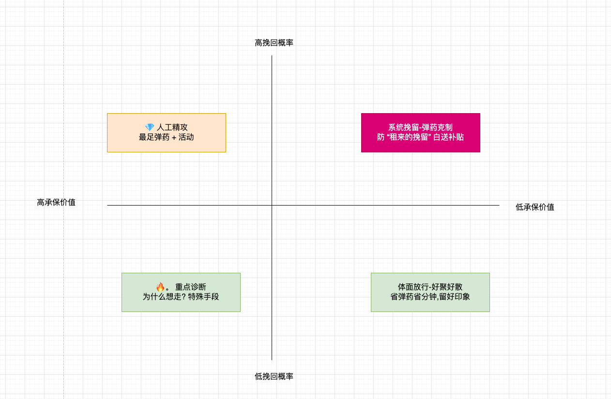
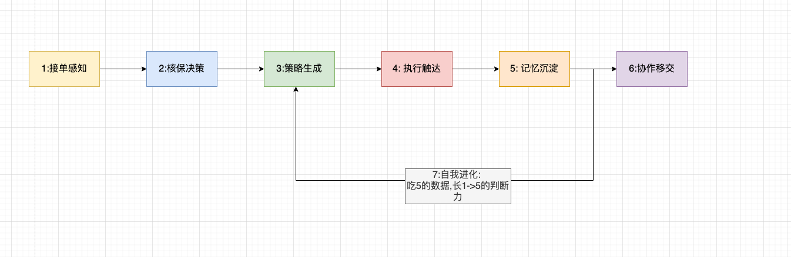

# 【PRD】商家挽留Agent(产品形态)

>版本1.0（产品形态定稿 -不含技术方案）
> 状态
> 本文档作为本Agent的业务形态设计（脱敏后）

---

## 1.一句话定位

**商家挽留环节的""核保大脑 + 销售教练 + 记忆系统" --以Agent作为唯一的产品形态，最终成为挽留队伍的正式编制**

产品不是 “工作台+AI插件的形式”,而是:Agent是唯一的作业体,界面只是Agent能力的外化,当前由10人挽留专业承载的识人,算账,定策,开口,记账,五件事全部由Agent承接;
人逐渐退步到“确认者->异常处理者->教练”的位置.

---

## 2.业务背景与问题定义

- 业务挽留小组10名专员,专门外呼挽留有解约意向的商家
- 去年至今产生xx亿的营业额.近一个月接近12w的任务量。累计挽留任务一半

---

### 2.2 原始痛点清单（专员视角）与真实病根(生意视角)

| # | 原始痛点 | 真实病根 |
| --- | --- | --- |
| 1 | 外呼前查询4-5个系统.耗时10-15min | 外呼前没有决策环节:没有人判断这一单值不值得挽留,该采取什么策略 |
| 2 | 挽留方式单一,无数据支撑和活动反馈 | 策略不按商家分层匹配;活动弹药可用性未确认 |
| 3 | 产品价值无法结合商家经营信息透传 | 却“经营状态 X 险种价值”的翻译能力,全凭专员的脑力 |
| 4 | 外呼后无复盘,无策略沉淀 | 环节无记忆,话术有效性，挽留质量,解约原因三样数据全部流失 |

### 2.3 病根之下,四个被掩盖的更大的问题：本产品要解决的核心问题

1.  **计分牌失真** 成功率/保费口径不一,无二次解约率,分不清 "真正留住"和""是免费租来的挽留"
2.   **核保缺位**  挽留环节只有销售,没有核保，超赔的商家被花钱劝下来续约,继续亏损（错误挽留）。优质商家被同一套平庸的话术打发走-错误流失.两笔损失没有可度量
3.  **长尾裸奔** 月12w的任务量（可能持续增长）远超10人的产能,至少3/2的renew没有及时触达。
4.  **数据资产废弃** 外呼中的验证有效的话术没有沉淀.

---

## 3. 生意本质和价值主张

### 3.1 这门生意的本质

利润 = 保费 - 理赔。 挽留环节同时握着这个公式的三个变量

- **留存商家数** （销售: 把人留住） ---当前有挽留专员做,效率太低
- **单商家承保质量** (核保,需要对商家分层-需要留住的是谁)  ---**当前无人做,产品的增量**
- **留存时长** (LTV:留住多长) --当前无人度量

**核心判断: 挽留率 100% 是灾难** 产品要做的不只是"多挽留",而是“挽留谁” -- 把资源从错误挽留挪向错误流失，承保利润= 净增.

### 3.2 价值池(按生意价值排序)

| 排序 | 价值池 | 来源 | 量级判断 |
| --- | --- | --- | --- |
| 1 | 核保重排 | 挽留资源从超赔/零价值单挪向优质单 | 不增加任何工作量，年化过亿级承保利润改善 |
| 2 | 销售提效 | 问卷原因直连话术+优质商家精攻 | 成功率 + 10pp =数亿/年保费 |
| 3 | 长尾覆盖 | 从未被触达的任务由系统自动挽留 | 纯增量保费,边际成本趋为0 |
| 4 | LTV管理 | 二次解约率纳入计分牌 | 挤出账面水分 |
| 5 | 产品反哺 | 解约原因矩阵驱动上游产品改进 | 不可量化的复利 |
| 6 | 产能释放 | 准备10～15min -> 10s | 产能几十倍提升 工具层价值 |

### 3.3 商家解约的三种原型(策略匹配 的基础)

| 原型 | 画像 | 真实动因 | 挽留本质 |
| --- | --- | --- | --- |
| 价值怀疑型 | 动销好,未超赔 | "保费是纯成本,未出过险没用" | 价值重叙:把成本讲成经营工具 |
| 知情缺失型 | 批量签约/活动代签/以险代罚 | "我根本不知道开通了这个" | 知情修复:先解释来源,不是推销 |
| 成本抱怨型 | 超赔商家 | 风险定价调高,只看到涨价 | 止损谈判: "贵是因为您真在用" |

> 注: 策略会随着数据飞轮从记忆中不断提炼。这也是Agent 离线记忆系统的作用之一

### 4.2 产品灵魂: 挽留价值分 （四象限）

每个解约任务进入Agent的瞬间,Agent 判定其**承保价值 X 挽回概率** 归入四象限 

**价值分的三个出口**

1. **资源分配**: 四象限决定该单进 “人工队列”,“系统自动处理”,还是体面放行
2. **话术档位**: 💎 拉满弹药 /右上温和留 / 右下送客话术
3. **记分口径**: 只有 “值得留的单”的挽留任务成功计入有效挽留保费

### 4.3 终局形态和演进路径(Agent主导,专员为副)

产品终局:Agent是挽留队伍的正式编制，直接面向商家完成挽留，10名专员转为两个队伍:

 - 1: **特种队** （接Agent移交的高危疑难任务）
 - 2: **教练队** (质检Agent话术,纠正边界case,投喂经验).

| 等级 | 形态 | Agent职责 | 人职责           | 晋级门槛（数据说话）            |
| --- | --- | --- |---------------|-----------------------|
| **L1情报官** | 作战卡 | 画像,意图,痛点全就位 | 全部决策-执行       | -                     |
| **L2副驾** | 建议者 | 价值分,策略,话术 | 决策+执行,可采纳可不采纳 | 话术采纳率> 60%.价值分回测准确率达标 |
| **L3 分流官** | 任务分配者 | 长尾单自动挽留;价值分接管任务分配 | 只见“该见的单”      | 长尾自动挽留成功率 >= 人工基线     |
| **L4挽留官** | 主导执行者 | 对商家直接触达挽留 | 特种队+ 教练队      | 合规通过;商家投诉率,留存率不劣化     |

**三条设计总纲**

1. **能力一次性建成** --不存在""副驾专用/主导专用"两套能力,晋级是提升权限,不是重构
2. **置信度是自主性的货币** -- Agent 每项输出自报把我程度,自主等级的提升靠置信度阈值校准,不靠人拍脑袋
3. **人在环路中移动位置而不是消失**   --从操作者到教练,人的经验永远是Agent的训练数据
---
## 5. Agent 能力规格

### 5.0 设计原则

- 每个能力 = 感知 -> 判断 -> 行动 -> 复盘 的完整闭环单元
- 所有能力服务于一条主线: **判断这单值不值得留 -> 懂这家商家 -> 定打发 -> 把话说出去  -> 把结果记回来 -> 下次更准**
- 从L1到L4的提升 是 “执行权”随战绩逐级提升

### 5.1 能力地图（七组 21项）

#### 1:接单感知组 --- "任务到我手里,我已经知道一切"

| # | 能力 | 定义:输入->输出 | 边界和红线 |
| --- | --- | --- | --- |
| A1 | 商家全景整合 | 解约任务触发 -> 自动整合经营数据，签约历史，等 | 数据只取真实值，宁缺不要编 |
| A2 | 解约意图解析 | 问卷原文/商家留言->结构化意图:原因分类(成本抱怨/价值怀疑/知情缺失/经营困难),情绪强度，紧迫感 | 问卷是第一信号源,无问卷时从行为推断并标注置信度 |
| A3 | 经营痛点探查 | 画像数据  -> 这家店此刻最疼的事儿 | 痛点必须可追溯到具体数据,不允许泛泛而谈 |

#### 2: 核保决策组 --- "这单要不要留,值多少资源" 

| # | 能力 | 定义 | 边界和红线 |
| --- | --- | --- | --- |
| A4 | 利益核算 | 商家+产品费用流,赔付率 -> 留住的预期承保损益（正/负,多大） | 连带产品计算:超赔核保结论天然 “不值得” |
| A5 | 挽回概率评估 | 分层,动销,白名单,险种属性,意图强度 -> 挽回可能性 | 复用业务现成三规则 |
| A6 | 挽留价值分 | A4 x A5 -> 四象限归位 + 资源档位 | 每个分数自带置信度与依据链; |
| A7 | 自知之明 | 每项输出自主把握;低把握单主动亮 “建议人工” | Agent主导形态的准入证 |

#### 3: 策略生成组 --- “对这家商家,这一单怎么打”

| # | 能力 | 定义 | 边界和红线 |
| --- | --- | --- | --- |
| A8 | 打法规划 | 价值分 + 意图 + 画像 -> 策略档位（精攻/温和/送客）及价值切入 | 话术不得越过核保结论:超赔单禁止最足弹药 |
| A9 | 价值翻译 | 险种价值 x 经营状态 -> "这个产品对你这家店的作用"的动态陈述 | **产品差异化灵魂**:不允许每个商家用同一套说辞 |
| A10 | 话术生成 | 档位+意图 + 商家实时反应 -> 口语化话术,温和版/算账版可切换,可实时重生成 | **全产品第一铁律:任何数字必须有真实数据出处** |
| A11 | 送客话术 | 体面放行话术(感谢+好聚好撒 + 复活动欢迎) | 建议展示,不自动执行 |

#### 4: 执行触达组 --- “把话术出去,把动作落地”

| # | 能力 | 定义 | 边界和红线 |
| --- | --- | --- | --- |
| A12 | 消息触达 | 策略+话术 ->商家可收到的挽留消息（文字先行,语音后置） | **触达频控从第一天生效** |
| A13 | 流程执行 | 商家自助侧:可智能挽留判定->自动挽留应答;不可挽留->固定留资引导;强制解约前置校验;不可单独解约校验 | 需要做好门控 |
| A14 | 活动报名 | 匹配弹药并一键报名 | 需要运营确认（预算，可报名活动,报名通道） |

#### 5: 记忆沉淀组 --- "复利的全部来源(所有等级满负荷运转)"

| #   | 能力   | 定义                                 | 边界和红线                          |
|-----|------|------------------------------------|--------------------------------|
| A15 | 战果归档 | 每单的打发,商家反应,成败,->结构化归档              | 人主导一键10S导入。agent主导自动归档:上线第一天运转 |
| A16 | 留存回溯 | 挽留成功单 -> 30/90天 二次解约追踪 ->识别 “租来的挽留” | 需时间窗,越早上线越早有数据                 |
| A17 | 原因回收 | 全量解约 -> 产品 x 类目 x 原因矩阵             | 输出给其他团队的漏水点地图,利润之外的第二产出        |

#### 6: 协作移交组 --- Agent主导形态的生死能力

| #   | 能力   | 定义                                                   | 边界和红线                |
|-----|------|------------------------------------------------------|----------------------|
| A18 | 移交求助 | 低置信度/高危/情绪激动单 -> 连同完整的上下文（画像+ 价值分 + 已试打发 + 商家反应）移送人工 | 移交不是失败,是设计:绝对不甩白纸    |
| A19 | 受教修正 | 人的每次纠正 -> 学习信号,改变后续同类单的策略选择                          | 人的纠正 正是最贵的训练数据,必须有落点 |

#### 7: 自我进化组 --- "越干越强的机制"

| #   | 能力    | 定义                                            |
|-----|-------|-----------------------------------------------|
| A20 | 策略调优  | 战果数据 -> 话术有效性表（哪类话术 x 哪类商家真有效） -> 自动修正打发和话术选择 | 
| A21 | 记分与自证 | 持续统计采纳率，成功率,与人工对照差异 -> 产出晋级证据包                |

#### 6.1: 能力权限矩阵(同一套能力,四级放开)

| 能力组   | L1情报官    | L2 副驾 | L3 分流官   | L4 挽留官     |
|-------|----------|-------|----------|------------|
| 1: 感知 | ✅ 全开     | ✅     | ✅        | ✅          |
| 2: 核保 | **只展示**  | 展示+回测 | 长尾单自动执行  | 中高价值单自动执行  |
| 3: 策略 | 建议->可以丢弃 | 建议为主  | 长尾单自动执行  | 中高价值自动执行   |
| 4: 执行 | ❌        | 人执行   | 长尾自动+频控  | 全自动+频控 +合规 |
| 5: 记忆 | ✅ 全开     | ✅     | ✅ + 自动归档 | n ✅        |
| 6: 协作 | 雏形（亮置信度） | ✅     | ✅        | ✅ (人变成教练)  |

#### 7.业务层形态

#### 7.1 A线: 专员作战(嵌入作业工作台)

**A1. 作战卡（外呼前,产品门面）**
打开任务即见 10秒读完:
- 商家是谁（基础信息,主营类目,层级星级
- 解约什么,为什么（**问卷原文引用**）
- **挽留价值分 + 象限 + 建议策略档位**（含置信度）
- 三条经营痛点
- 建议价值切入点

验收口径: 单任务准备时长从 10～15 分钟降低1min内

**A2.话术副驾（外呼中)**
- 按象限 + 解约原因生成**分层话术** 💎用算账版本（数据杠杆,星级流量帐）;
知情缺失型先修复知情（“您是被 XX 活动自动签约的”）；超赔商家给送客版建议
- 问卷原文直达话术第一句（"看到您提到理赔慢...."）
- 一键切换温和版/算账版本；专员现场补一句商家新异议 -> 话术实时重生成
- **铁律：任何数字必须有真实数据出处**

**A3 弹药库（外呼中,条件启用）**
活动匹配与报名功能整体需要门控

#### 7.2 B线 长尾智能挽留（商家自助侧,无人工）

- 判定可智能挽留任务（三规则）-> 按解约原因给**一条**针对性挽留文案
- 不可智能挽留 -> 固定话术引导留资挽留小组
- 强制解约必须过挽留环节: 不可单独解约产品校验（代码配置 + 产品依赖配置）
- **问卷页第一触点**: 商家填完原因那一刻给实时应答--比外呼早,比外呼自然,性价比最高的挽留触点
- 本线同时是L3/L4 形态的作战预演: agent 独立作战能力的证据链从这里攒

### 7.3 C线: 经营复盘

 - **计分牌**：有效挽留保费（利润口径）替代成功率
 - **话术有效性表**: 哪类话术话术 x 哪类商家 -> 当场成功率 + 60天留存率（喂回话话术生成）
 - **解约原因矩阵**: 产品 x 类目 x 原因 ->上游产品漏水点位图

---

## 7.度量体系

| 层       | 指标         | 说明                                            |
|---------|------------|-----------------------------------------------|
| **北极星** | 月有效挽留保费    | 利润口径，防止靠挑软柿子或白送补贴刷成功率                         | 
| 过程      | 话术/作战卡采纳率  | **1.0 最大失败风险** 不采纳,一切归零                       |
| 过程      | 单任务准备时长    | 10～15分钟 < 1分钟                                 |
| 过程      | 价值分准确率     | 四象项回测命中率,决定L3能否到来                             |
| 护栏      | 二次解约率（60天） | 防”租来的挽留“                                      |
| 护栏      | 对照组差异      | 上线即留 10～20% 任务不接Agent-唯一能量化真实增亮的设计，**事后无法补建** |
| 护栏      | 商家触达投诉率    | L3 后防止挽留变骚扰                                   |