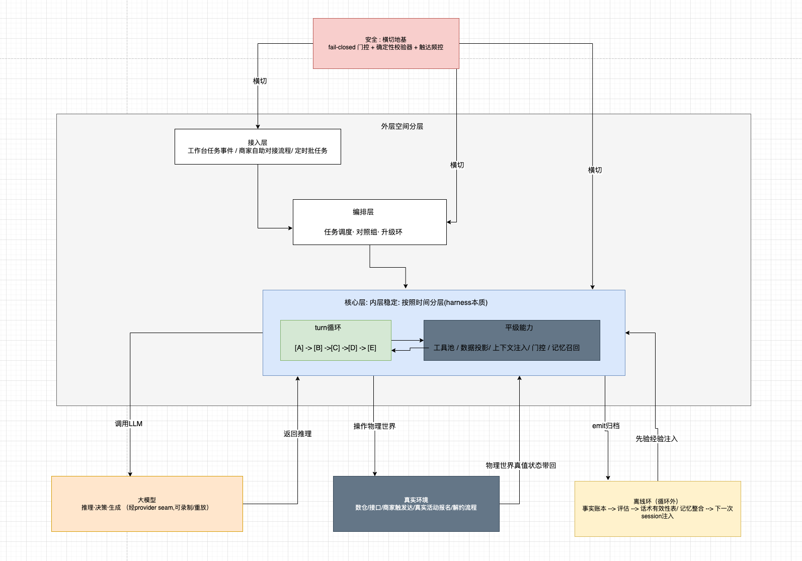
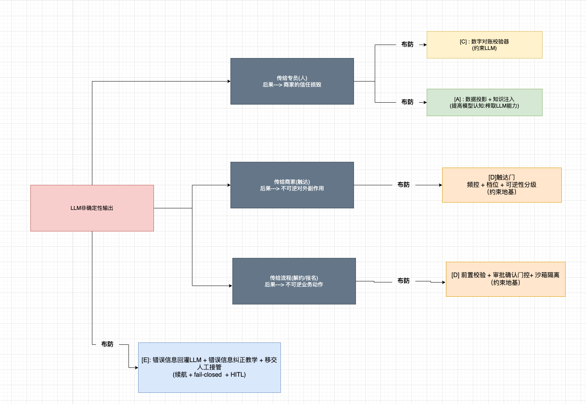
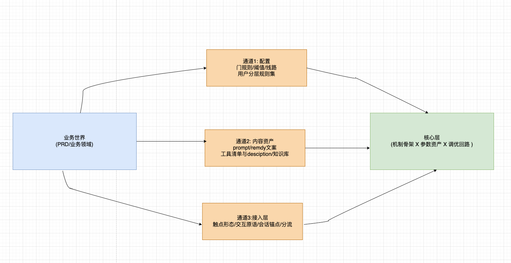
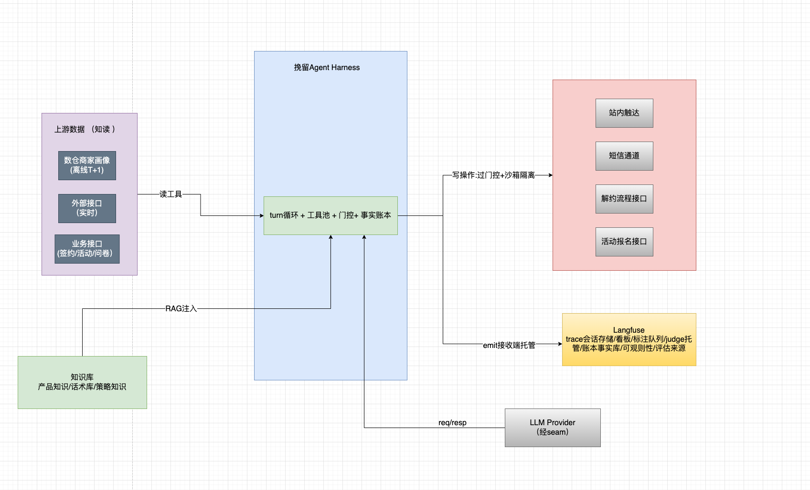

# 挽留Agent详细技术设计方案 - 00 总览

> 配套产品文档  doc/prd/商家挽留Agent.md
> 设计方法论: Agent = Harness + LLM (设计来自: Harness工程设计方法论)
> 版本:1.0

---

## 1. 一句话架构

**一个turn 循环 + 一组平级能力（工具/注入/记忆/压缩/门控）,Harness的本质是 LLM本身是一个不确定性单元。所以我们应该沿着"非确定性传播的路径"
逐站布防,产品红线全部做成确定性门控，不赌模型自觉; 经验 经过 '事实账本-> 评估-> 记忆 形成离线进化环‘**

> 图0-1: 总体架构 -- 外层空间分层 X 内层时间分层, 安全行为横穿各个阶段, 离线沉淀记忆

## 2. Haness的第一性原理对本方案的映射

Harness的第一性原理:**沿着LLM本身产生的非确定性传播路径进行逐级布防,榨取LLM能力和约束LLM行为双线并行**

我们的域的非确定性从LLM产生(杜撰数字的话术 /错误的价值分/ 越过核对的弹药策略), 沿着三条路径传播,每条路径终点都有对应的防线

>  图0-2: 非确定性传播路径 X 布防点。绿 =榨取LLM能力（提高LLM正确率）,黄 = 约束(降低出错) + 榨取 双性,红 = 约束地基,蓝 = 续航兜底
>  榨取和约束的责任划分原则: 
> 榨取: 凡是语义判断的（话术生成,意图理解,痛点翻译,错误自纠）交给LLM,并且通过投喂更高质量的上下文(context engineering) 来提准确率 (数据投影 + 知识投入 + 记忆召回)。
> 约束: 凡是能确定性判定的绝不交给LLM判 (核保三规则,商家信息中数字对账,频率控制,档位门控制 全是代码) 

## 3. 任务型 harness的定型判断

我们的任务形态: 一次挽留任务 = 一个 6～10轮次的pipeline (查数 -> 洞察 -> 定策 -> 话术 -> 执行 -> 归档 ),不是REPL.由此定型。

## 4. 分层理论: 机制稳定,内容变化,调优是内层的第一公民需求

> 本方案所有章节在调优的时候公用一把尺子: 分层 = 变化率的分层。每一层 “为什么变,凭什么变,怎么变,变了怎么保安全” 各有各的答案,混了分层就乱了架构

| 变化层 | 变化原因 | 证据来源 | 变更通道 | 安全机制 | 变化速度 |
| --- | --- | --- | --- | --- | --- |
|  业务形态（接入层,编排层的内容:触点,线路规则,四象限规则集） |  产品形态变化了  |  PRD/业务方决策 | 接入层代码 + 线路配置  | 灰度,对照组  |  快（随版本） |
| 参数与资产（权限阈值,门阈值,prompt remedy文案(纠正提示词),tool desciption,记忆条目,数据投影方案)  | 调优  | 事实账本数据（每次seesion会话日志,挽留成败,留存,门误拦率,采纳率）  | 配置/资产文件,不碰核心代码  |  relay回归 + 某指标下降 + 收敛判断(04章节:评估和可观测性 8步循环) | 持续调优(周)   |
|  机制骨架(turn循环5个hook点,审批阶梯,对账模式,账本纪律,记忆五阶段) | harness工程学本身的进步  | 业界探索进步  | 核心代码重构 + 架构评审  | 全量回归  | 极慢（季度/年）  |

> "内存稳定"的精确含义: 不是不变,是变化各有各的原因,节奏,证据,和通道。机制骨架的稳定性是有实证背书---ClaudeCode/deepSeekHarness/Codex
> 三个互相独立团队,不同的业务独自演化出一套核心机制（turn时间轴,审批阶梯,LLM错误教学回灌,事实账本纪律）。说明这些机制是由"LLM本身非确定性" 这个
> 物理事实决定的，不由业务决定。但是Agent的产品承诺: "越用越聪明" --如果没有中间层的持续变化,这个承诺就是假的。
> 但是中间层的存在 恰恰依赖 ”04章评估体系“: 评估在这套架构里面不是质量保障流程,他是核心层的变更管理标准,没有评估。核心层的变化是不可靠的。不能变化的

## 6. 业务层和内层引擎层的分界判断:
> 证据来源测试: 一段设计/代码,问它为什么会存在---答案: "因为LLM会出错" 这就是进入核心层;
> "如果是业务属性"的信息 则进入外层
- 例如: 数字对账器为什么会存在? 因为“LLM会杜撰数字”-> 进入核心层. 对账的数据引用集 为什么有loss_ratio_90d: 因为业务概念-> 进入外层biz

### 业务进入核心的三条通道

## 7: 系统边界和外部依赖

**关键边界纪律**
  - 读工具宽容,写工具需要全过门控(门控严格性按照操作环境可逆性分级).
  - Langfuse 是接收端委托,不是内核 --- 事实账本schema,seam,评分设计自持，
  - 知识库的读取注入,写入（专员纠错,话术沉淀）走离线环节异步写入（经验沉淀）,需要带审核门控.

---