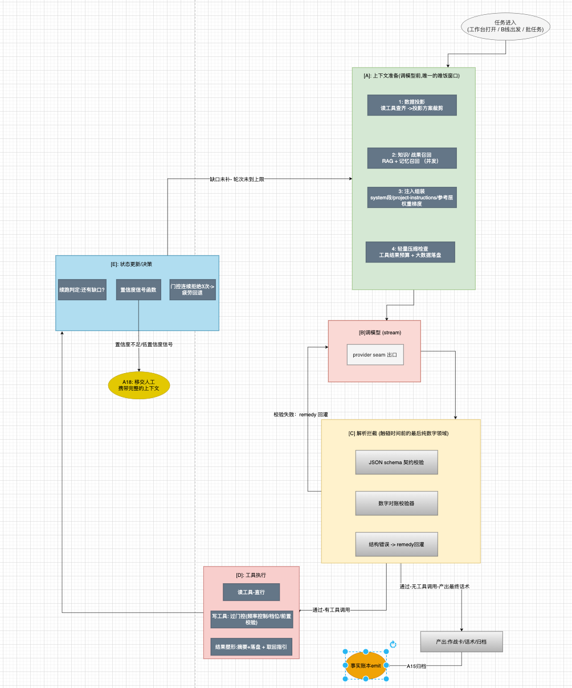
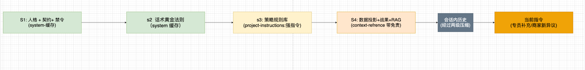

# 挽留Agent 技术方案: - 01 核心层: turn循环

> 核心层不是空间嵌套,是**一个 turn循环 + 一组平级能力** 能力在空间上平级,时间上由循环编排先后.
> 本章定义: 时间上五站详设,[A] 数据投影与权重注入梯度,轻量压缩,[C] 校验，[E] 置信度与移交


---

## 1.1 turn 时间轴总图



> 图1.1: turn时间轴五站.[A] 能力榨取（投喂高质量的上下文）[C] 约束+榨取 （校验+remedy）,[D] 约束地基（门控）,[E]: 续航 + fail-closed(移交给人工),错误永不抛出异常终止 
> --回灌自纠或者移交:两条路都有下一步。

**轮次上限**: 任务型harness 设  `max_turns = 16`.（正常6-8步,超过限制设置喂不可收敛）.走到上限认为是不可收敛。到上限走A18->移交。不无限循环。

## 1.2 [A]: 数据投影: 压缩链的我们域形态

"压缩(compact)" 是 “防线上唯一出错会放大非确定性”的高危点。我们的会话短,传统压缩压力小: **等价的高危是商家数据投影**--全量注入商家近30天的订单/理赔期明细会淹没模型,注入太少则话术缺乏弹药。
设计原则：**数据投影方案需要显示定义,可审计,宁少勿错**。


### 数据投影分级（当压缩级管理）


| 级 | 内容 | 何时进入上下文 |
| --- | --- | --- |
| P0指标层 | 经营指标摘要(订单量/销售额/好评率/星级/赔付率/动销),各一行一数 | 每任务必进 |
| P1 证据层 | 痛点证据(不良体验top3 原文，问卷原文,解约原文) | 每任务必进 |
| P2 明细层 | 订单趋势曲线,活动参加历史数据 | **不进**,落盘 + 取回指引,模型按需用read工具拉 |
| P3 原始层 | 数仓原始字段全集 | 永不进入循环，账本留trace_id 可回查 |

**本质** 本质是对工具结果的压缩

**落盘+预览+取回指引** :P2数据写任务暂存目录,上下文只放 少量的预览 + `完整的明细已存磁盘 + 可以用read(claim_detail,offset,limit)分页查看`。使得模型获得变焦能力: 默认看指标,写""算账本"需要
理赔明细时自己拉。

**数字对账的锚点在此产生**: 每个进上下文的数字 带 `data_ref` （如 `近90天满期赔付率  118% [ref:claim_stats.loss_ratio_90d]`）.[C]的对账器按ref反查
--这是""数据不得杜撰"的红线的机械实现。不是prompt恳求.

### 轻量级压缩（两级：够用就行）

| 级  | 内容                                       | 何时进入上下文  |
|----|------------------------------------------|----------|
| L1 | 工具结果buget:单条tool_result超8Ktoken -> 落盘+预览 | 每轮 [A]   |
| L2 | 累计超窗口85% -> 丢弃最早轮的工具结果 content (保留 [ref] 占位) | 每轮 [A]   |


---

不做autocompact 整段摘要--6-8轮会话里会触发2它的概率为0，为它建立LLM摘要管道 不值得;真触发L2后仍超,直接走  [E] 移交出去


---

## 1.3 [A] 注入权重梯度

注入的权重由**位置+标签**共同决定，确定性指令与参考上下文必须分层,本项目的五层：

| 层 | 位置 | 内容 | 权重语义 |
| --- | --- | --- | --- |
| S1 | system段(缓存) | 人格（挽留顾问）+输出契约 + 工具使用纪律 + 禁令清单 | 恒定高权重,每次任务算一次 |
| S2 | system段 | 话术生成黄金法则(先共情/锚定成本/场景化/价值对冲/禁止杜撰) | 恒定 |
| S3 | `<project-instructions>` | **策略规则库**:星级策略,层级策略,赔付率策略，签约话术来源 | 确定性指令,不包免责申明 |
| S4 | `<context-refrence>` 带责 | P0/P1 数据投影,召回的相似结果（记忆），RAG检索的产品知识片段 | “供参考,数据以工具查询为准” |
| S5 | tools字段 | 工具池（按象限档位动态裁剪可见性） | 平级能力 |




> 图1.2: 最终请求剖析,S3是产品策略(人写的确定性规则)。S4是"可能相关"的参考资料--- 分层防串味:策略规则不会被参考数据的噪声稀释,参考数据不会被
> 当成铁律。

>注入时序(并发藏延迟): 任务触发事,数据查询(A1） 与战果召回(记忆) 并发启动; 压缩检查串行随后；S3/S4 组装在调模型之前完成。

---

## 1.4 [B]  provider seam 

所有LLM调用流经单一可替换边界

```java
interface  LLmProvider {
    
    Stream<LlmChunk> complete(LlmRequest req);
    
}

class ReplayProvider implements  LLmProvider {
    
   Stream<LlmChunk> complete(LlmRequest req) { return recorded(req);}  
}
```

纪律:seam 是04章 重放测量的物理基础; **未经seam的LLM调用视为违规**(review 检查项))。每模型的req/res 按照req录制进入账本事实

---

## 1.5 [C] 解析拦截与数字对账

[C] 的判断限定**结构层**,刻意回避语义判断(不引入新非确定性)。三道:

1. **结构契约-三层来源(按优先级,防 “prompt 逼JSON”回潮)**
    - **a.工具协议（首选）** : 需要结构化产出的场景 (A2 意图四分类,价值分),注册**提交类工具**(如`report_intent（category,emotion,urgency` ---scheme挂在tools定义
上,由API协议承接,模型在协议约束下生成,[C] 对协议产物做safeParse 兜底.协议有schema语义,校验有确定性锚点，错误回灌有结构可依)
    - **b. 自然语言交付(话术/p1产出)**: 不做结构化要求-由第2道对账器从自然语言中提取校验，不是所有的产出都该是JSON;话术的价值在人读，不在机读
    - **c. 校验兜底（[C] 本职）**: 对a的产物safeParse（失败-> remedy回灌），对b的 自由文本做数字对账/域回正. **校验是防线,不是形态要求**
    - **禁止**: 用prompt 指令要求模型手写JSON文本（无协议校验,错一个逗号整轮废,已证实劣于工具通道.）

2. **数字对账校验器**（本方案核心校验）:提取话术中全部数字/百分比/金额 -> 逐个对`[ref]` 数据集: 
   - 归一化匹配(118%/百分之一百十八 / 1.18 三写法先静默归一: **先原谅再教学**)
   - 匹配失败 -> 打回, remedy三段式: `话术中 [赔付率300%] 无数据出处,真实值:近90天满期赔付率 118%[ref:claim_stats.loss_ratio_90d]。请基于真实值重写`: （事实+ 因果 + 出路）
   - 连续3次对账失败 -> 不再重试.降级为 “仅输出不含数字的话术” + 在作战卡标注“数据校验未通过”.
3. **档位一致性校验**:  超赔单(核保 = 右下象限) 产出的话术若含弹药类承诺(活动赠送/升级方案). [C] 直接拦截-- 这是 "话术不得越过核保结论"红线
4. **任务锚点交叉校验**: todo 


