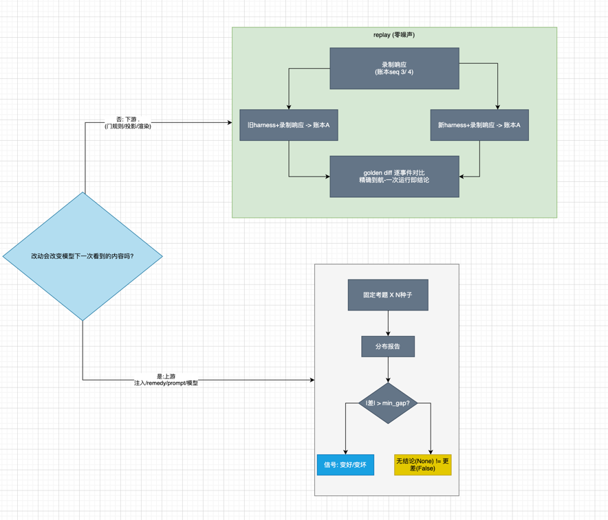
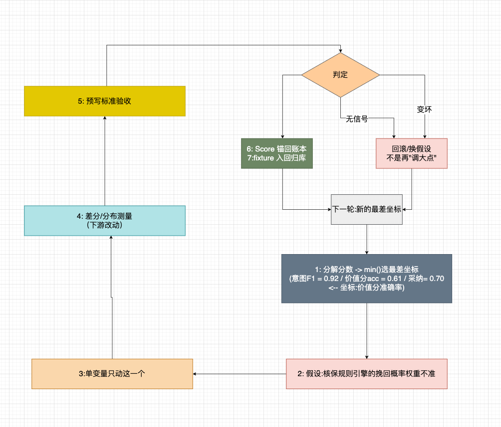
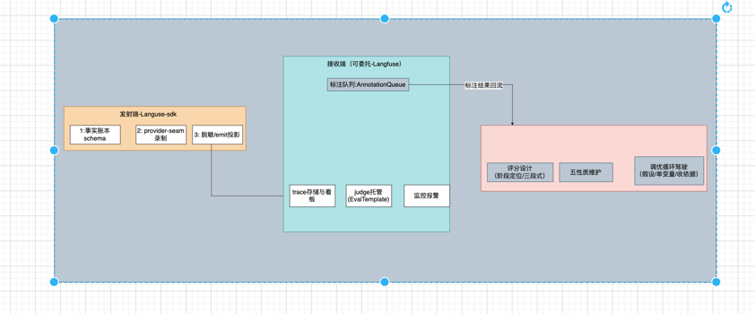

# 挽留Agent 技术方案 - 04评估体系

> Agent调优没有类似于ML(机器学习)一样的"梯度下降"用于调优方向--评估体系就是"梯度下降"的替代品.没有它,调优是玄学
> 四病灶: 信号噪声不分 / 多变量不可归因 / 失败不可定位 / 改进不可保。
> 本章定义: 事实账本,评分设计三段式,量化阶梯, replay/experiment 双测量，调优循环, Langfuse 委托边界

---
## 4.1: 事实账本设计**

**事实账本 = append-only事件流** 每任务一条trace,按seq 可回答 "第N步发生了什么":

```yaml
trace_id: ret-20261012-000123
task: {"line": "A","vendor_id": "1625242","ins_type":5999,"quadrant": "人工精攻","intent":"成本抱怨",
     "rule_hits":["B2","动销","超赔否"]}
events: 
  - seq:1: {"type": "tool_call","tool":"vendor_profile","arg":{...},"value_digest":"{....}"},
  - seq:2:  {"type": "llm_call","tool":"claim_stats","value_digest":{"loss_ratio_90d":1.18}},
  - seq:3:  {"type": "llm_call","model":"...","req_hash":"...","resp_req":4},
  - seq:4:  {"type": "llm_resp","intent_label":"成本抱怨","quadrant_pred":"💎"},
  - seq:5:  {"type": "gate","gate":"档位门","verdict":"pass","detail":{"...."}},
  - seq:6:  {"type": "guard_fail","check":"数字对账","bad":"赔付率300%","remedy_given":true},
  - seq:7:  {"type": "llm_resp","script_final":"...","numbers_all_refd":true},
  - seq:8:  {"type": "deliver","kind":"作战卡+话术", "confidence":"0.86"},
  - seq:9:  {"type": "human","adopted":true,"edited":false,"note":""},
  - seq:10:  {"type": "outcome","result":"挽留成功","ts":"...."},
  - seq:11:  {"type":"retention","d30":"留存","d90":"留存"}
```

**五纪律**: 
- append-only(API形状保证);
- 崩溃合成闭合; 
- 每个数字带 [ref]；
- 门判定全留痕；
- 人机交互(采纳/编辑/否定) 必须入账。

**为什么 trace 是这个形状**
- seq 1-8 支撑 replay 重放(harness侧改动保持0噪声差分);
- seq 9 支撑采纳率

---
## 4.2量化阶梯: 每层产出物它配得上的手段

**错配即废指标**: 我们的产出物定位

| 阶梯层 | 我们的产出物 |             量化手段              | 真值来源 | 成本 |
| --- | --- |:-----------------------------:| --- | --- |
| 6: 环境断言(最硬) | 挽留成败, 30/90天留存,报名成功 |         二值（true/false         | 环境自带-- 查签约状态即可知 | 免费 |
| 5: 分类对照 | 意图四分类,价值分四象限 | label对照,confusion matrix;逐类F1 | 人工标注集（首批300任务,双人标注+仲裁评审） | 一次性成本 |
| 4: tool_call | 工具参数对错,数字对账通过率,门控判定 |  三层拆:选对工具 ->参数匹配（结构对照）->执行成功  | 结构断言,代码判定 | 免费 |
| 3: 序列对比 | 轮次效率,重复话术率,门连拒率 |                               | 结构断言,机器判 | 免费 |
| 2: 偏好/rubbic (最软的生成层) | 话术质量 | rubric维度区分.pairwise偏好,judeg判定 | judege-专员pairwise投票("哪个更好"比 “打几分”更有信噪比) | 中 |
| 1: 用户体验(最真) | 采纳率,编辑率,复用率 |                               | 隐式反馈 | 免费 |
> 本项目的成本优势: 只有第2层 需要人/judge  第6层真值免费并且海量 （挽留成败是市场直接给的分数） --评估体系运行成本极低,
> 这是本域做数据驱动调优的天然优势

## 4.3: 评分设计: 主指标 + 约束 + 分解.绝对不要合成

```
调优期:
 maximize   挽留成功率                         <-  主指标（唯一被优化的量）
 subject to 数字对账通过率  = 100%              <- 约束 (红线,不参与优化)
            频控违规次数 = 0
 
 并列报告(分解,诊断用):
            意图F1 / 价值分准确率 / 采纳率 / 话术质量分 / 门误拦率   <- 坐标下降的方向盘

```

**错误的设计**: 将各个指标做加权平均分: "成功率 * 0.4 + 采纳 * 0.3 + ..." 
- 1: 权重无法调优
- 2: 从最终的分数看不出来哪个指标的问题

```text
主指标（循环吃到的） = seq 10当日挽留成功       <- 天然节奏,与调优循环节奏匹配
真值终点(对表用的)  = seq 11 d30/d90 留存     <- T+30/90 回写,循环等不起
代理链:    seq9采纳   -> seq10 当日挽留 -> d30留存   -> d90留存

```

**Goodhart防线(对本域特别真实）**: 采纳率（专员爱用）与挽留成功率（商家真留）可能有分叉 --话术越用越顺嘴被采纳，但是 顺嘴 !=有效
**每双周对表**: 采纳率高的分组,其真实成功率是否也高？ 相关性 -> 采纳率降位为观察指标,这条防线现在有精准的执法对象:它是代理链的第一环(采纳 -> 当日挽留)的逐环对表.

---

## 4.4: 双测量
**判定式:这个改动改变"模型下一次看到的内容"吗? **改变 -> 录制响应作废,走experiment;不改变（只消费已产出的输出） -> replay有效****

我们的四个主要工作面:


| 工作面 | seam侧 | 测量 | 说明 |
| --- | --- | --- | --- |
| 门规则(档位门/规则命中判定) | 下游（判seq4的预测） | replay | 纯浪费LLM |
| 投影/交付物组装(作战宣传卡渲染) | 下游 | replay | 同上 |
| 上下文注入(vendor数据进prompt) | 上游（塑造seq 3的请求） | experiment |   |
| remedy文本（喂给seq7那一call） | 上游 | experiment |   |



**min_gap判定式**:  先测指标固有波动,min_gap = 波动 + 余量；观察量< min_gap ->
返回"无结论" 而非"更差".

**考题资产(golden set)**: 从账本采历史任务建黄金标准集-已知结局的任务天然带真值;**好任务与坏任务都录入**（失败都fixture是回归库的第一批居民）;封存一半当留出
集防过拟合

---

## 4.5 ： 循环调优设计



图4.2: 坐标下降调优循环

**三个纪律**
 - 1: 单变量
 - 2: 噪声内不追(分解分数的波动 < min_gap不动作)
 - 3: 护栏拦截(变坏的改动进不了回归库,金标准保持)


**坐标会回来的处理** 改动A坐标导致B坐标回退0.01（在噪声内）-->不追原因; 回退超噪声  --> 先按照“上/下游” 给"改动"定性.下游回归用replay差分定位 （账本逐事件可见）
.上游回归用experiment分任务剖面定位(replay看不见上游效应--模型没被重调);定位到回归源,先修回归再继续.
---

## 4.6 评估函数-五性质维护

| 性质 | 我们的维护动作 | 周期 |
| --- | --- | --- |
| 1:区分度 | 用已知好/坏历史任务测,分数拉不开的指标废 | 指标上线前 |
| 2:稳定性 | 同考题10遍极差-> 定min_gap ->定种子数N >= 5 | 指标上线前 |
| 3:敏感面对准杠杆 | 改一个已知有效的小改动（如修一个门规则）, 不动 | 每次新增指标 |
| 4:Goodhart | 采纳率vs 真实成功率相关性表;相关性掉=采纳率飘了 | 每次新增指标 |
| 5:时间可比 | 话术rubric版本化:改rubric = 开新序列 + 重判历史乔接 | 每次rubric变化 |


## 4.7 Langfuse委托边界


## 4.8 落地产物和验收物

| 步 | 内容 | 验收物 | 量级 |
| --- | --- | --- | --- |
| 1 | 事实账本 | 按seq回答:"第N轮发生了什么" |   |
| 2 | provider seam + 历史会话录制 | 喂录制响应，真runtime确定性跑通 |   |
| 3 | 评分设计 | 阶段定位表+三段式+阈值表写下来 |   |
| 4 | 考题资产 + 双向测量 | 改一处门规则（下游）,replay一分钟内红绿；改一处注入（上游）出N种分布 |   |
| 5 | 判卷版本化 + 观测门控 | 每个分数可以“类型/配置/判卷版本” |   |

